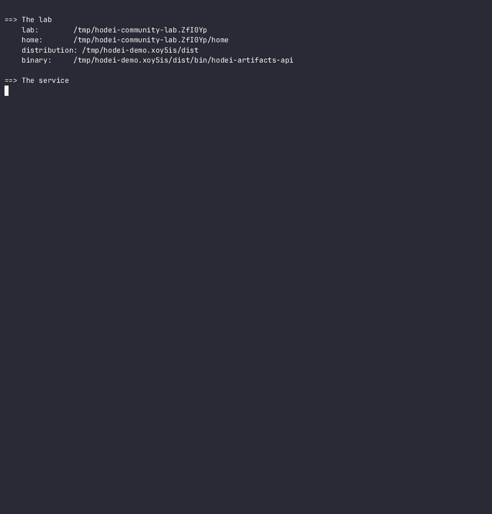

# Hodei Artifacts

> **Parte de la plataforma de seguridad [Hodei](https://github.com/hodei-security-platform)** · [English version](README.md)

**hodei-artifacts** es el registro de artefactos nativo en Rust de **Hodei**: alojamiento multiformato de paquetes, almacén direccionado por contenido, autorización Cedar ABAC y auditoría de seguridad en un único binario independiente.

[](LICENSE)
[](https://www.rust-lang.org/)

> **Estado actual:** lo que está implementado, verificado y excluido se detalla en **[ARCHITECTURE_STATUS.md](ARCHITECTURE_STATUS.md)**.



*Grabación real de `scripts/community-quickstart.sh run` (los digests y puertos varían en cada ejecución). Se regenera con [`scripts/render-demo.sh`](scripts/render-demo.sh); grabación de origen: [`quickstart-demo.cast`](docs/community/quickstart-demo.cast).*

---

## Perfil productivo: Dgraph + S3 (HSP-314 F2)

El build por defecto y el archivo/imagen OCI de release son el **perfil de grafo**: un Alpha de Dgraph es la autoridad única de los metadatos y los bytes viven en S3 (`RUN_MODE=dgraph`, `config/dgraph.toml`). El motor embebido SurrealDB/RocksDB es opt-in (`--features legacy`) y se retira en HSP-314 F4. Despliega con [`compose.external.yaml`](compose.external.yaml) (Dgraph + Garage + API), [`compose.yaml`](compose.yaml) (solo la API, con tu Dgraph y tu S3) o el [chart de Helm](charts/hodei-artifacts/README.md); véase [`docs/community/operations.md`](docs/community/operations.md). La investigación, los hechos de riesgo y el reactor de CVE no están cableados en este perfil todavía (HSP-314 F3) y siguen cerrados.

## Quickstart en 60 segundos (sin compilar Rust)

> **Laboratorio embebido, solo legacy.** El laboratorio de abajo levanta el motor embebido en un directorio temporal, así que necesita un binario compilado con `--features legacy`; el archivo de release (sin esa feature) rechaza el perfil embebido. Para un servicio real, usa el perfil de grafo de arriba.

Levanta un laboratorio local aislado desde el paquete de release: arranca el servidor, acuña un JWT efímero, crea repositorios `raw` + `maven2`, publica y descarga paquetes y verifica sus digests:

```bash
# VERSION and TARGET select the archive: véase "De dónde sale el archivo" más abajo.
VERSION=0.2.0
TARGET=x86_64-unknown-linux-gnu
PKG="hodei-artifacts-api-$VERSION-$TARGET"

# Verifica el digest del archivo, descomprímelo y ejecútalo.
sha256sum -c --ignore-missing "${SUMS:-$PKG.tar.gz.sha256}"
tar -xzf "$PKG.tar.gz" && cd "$PKG"
./community-quickstart.sh run
```

**De dónde sale el archivo.** `VERSION` y `TARGET` son los dos marcadores que resuelve el bloque (`TARGET` es `rustc -vV | sed -n 's/^host: //p'` en la máquina que lo construyó). Las releases se publican en <https://github.com/Rubentxu/hodei-artifacts/releases> como `hodei-artifacts-api-<version>-<target>.tar.gz` más un fichero `SHA256SUMS`; para una release define `SUMS=SHA256SUMS` antes del bloque (mismo formato `sha256sum` que el `.tar.gz.sha256` que [`scripts/package-release.sh`](scripts/package-release.sh) escribe junto al archivo). La última release publicada (`v0.2.0`) es anterior al quickstart comunitario y **no** incluye `community-quickstart.sh`: hasta que se publique una más nueva, construye el archivo desde un checkout con `scripts/package-release.sh` (escribe `dist/hodei-artifacts-api-<version>-<target>.tar.gz` y su `.sha256`) y ejecuta el bloque desde `dist/`. [`tests/hsp241_community_quickstart.rs`](tests/hsp241_community_quickstart.rs) extrae este mismo bloque y lo ejecuta contra el archivo que produce ese script, sin `cargo` en el `PATH`.


- **Guía completa de Quickstart:** [`docs/community/quickstart.md`](docs/community/quickstart.md) (o desde un checkout del repositorio: `scripts/community-quickstart.sh run --archive dist/hodei-artifacts-api-<version>-<target>.tar.gz`)
- **Guías de usuario por ecosistema:** [`docs/community/ecosystems.md`](docs/community/ecosystems.md) — [Maven 2](docs/community/ecosystems.md#maven-2-maven2) · [npm](docs/community/ecosystems.md#npm-npm) · [PyPI](docs/community/ecosystems.md#pypi-pypi) · [OCI](docs/community/ecosystems.md#oci-oci) · [Cargo](docs/community/ecosystems.md#cargo-cargo) · [NuGet](docs/community/ecosystems.md#nuget-nuget) · [Go](docs/community/ecosystems.md#go-go) · [APT](docs/community/ecosystems.md#apt-apt) · [RPM / Yum](docs/community/ecosystems.md#rpm--yum-rpm) · [Helm-OCI](docs/community/ecosystems.md#helm-oci-oci--helm)

---

## Por qué hodei-artifacts

- **Seguridad *fail-closed* por defecto:** la superficie administrativa (`/api/v1` IAM, políticas, esquemas, playground) está cerrada por defecto (`admin_api_enabled = false`); las rutas de negocio exigen JWT Bearer verificado y políticas Cedar ABAC por repositorio.
- **Direccionado por contenido y auditable:** hub de blobs deduplicado por SHA-256 (`hodei-hub` con CAS local o backend compatible con S3), registro de auditoría de seguridad y CLI `hodei-recovery` para copia, restauración y verificación (`scrub`).
- **10 ecosistemas de paquetes en un solo binario:** superficies de protocolo nativas para `raw`, `oci`, `maven2`, `npm`, `pypi`, `cargo`, `go`, `nuget`, `apt` y `rpm` (además de charts Helm sobre OCI), sin JVM ni pausas de GC.
- **Gobierno estricto de dirección pública:** `public_base_url` y `trusted_proxies` se controlan exclusivamente por configuración, nunca por cabeceras `Host` o `X-Forwarded-*` no confiables.

> **Regla de producción (TLS y firmas):** el servicio no termina TLS: en producción ponlo siempre detrás de un proxy inverso que termine TLS y declara la URL pública (`public_base_url = "https://..."`; ver [`docs/community/configuration.md`](docs/community/configuration.md)) y mantén activa la verificación de firmas e integridad (GPG en APT/RPM, digests/firmas en OCI y Helm-OCI, `integrity` SRI en npm, SHA-1/SHA-256 en Maven y PyPI). Los ejemplos con `http://127.0.0.1` están acotados exclusivamente a desarrollo y laboratorio offline.

---

## Matriz de capacidades (`GET /api/v1/capabilities`)

Derivada de [`RepositoryFormat::served()`](crates/hodei-catalog/src/model.rs), [`RepositoryFormat::serves_modes()`](crates/hodei-catalog/src/model.rs) y [`conformance.rs`](crates/hodei-catalog/src/conformance.rs):

| Formato | `hosted` | `proxy` | `group` | Prefijo de ruta HTTP |
| --- | --- | --- | --- | --- |
| `raw` | Sí | Sí | Sí | `/repository/{repo}/...` |
| `oci` | Sí | Sí | Sí | `/v2/{repo}/...` |
| `maven2` | Sí | Sí | Sí | `/repository/{repo}/...` |
| `npm` | Sí | Sí | Sí | `/npm/{repo}/...` |
| `pypi` | Sí | Sí | Sí | `/pypi/{repo}/...` |
| `cargo` | Sí | No | No | `/cargo/{repo}/...` |
| `go` | Sí | Sí | Sí | `/go/{repo}/...` |
| `nuget` | Sí | Sí | No | `/nuget/{repo}/...` |
| `apt` | Sí | No | No | `/apt/{repo}/...` |
| `rpm` | Sí | No | No | `/yum/{repo}/...` |
| `terraform` | Sí | Sí | No | `/terraform/{repo}/...` |
| `conan` | Sí | No | No | `/conan/{repo}/...` |
| `galaxy` | Sí | No | No | `/galaxy/{repo}/...` |
| `helm` | No | No | No | Solo declarado; los charts Helm usan `oci` (`/v2/{repo}/...`) |

---

## Seguridad y operaciones

- **Referencia de configuración:** [`docs/community/configuration.md`](docs/community/configuration.md) · **Operación:** [`docs/community/operations.md`](docs/community/operations.md) · **Plantilla de notas de release:** [`docs/community/release-notes-template.md`](docs/community/release-notes-template.md)
- **Superficie administrativa:** [`docs/security/admin-surface.md`](docs/security/admin-surface.md) y [`docs/security/production-auth.md`](docs/security/production-auth.md)
- **Acceso a repositorios y eventos de auditoría:** [`docs/security/repository-read.md`](docs/security/repository-read.md) y [`docs/security/audit-events.md`](docs/security/audit-events.md)
- **Copia de seguridad, restauración, scrub y reparación (`hodei-recovery`):** [`uat/UAT-OPERATIONS.md`](uat/UAT-OPERATIONS.md#recovery--copia-restauración-scrub-y-reparación)
- **Actualización y empaquetado de release:** [`scripts/package-release.sh`](scripts/package-release.sh) y [`docs/community/ecosystems.md`](docs/community/ecosystems.md#3-operaciones-copia-de-seguridad-restauración-y-actualización)
- **Visión general de arquitectura y seguridad:** [`docs/architecture.md`](docs/architecture.md), [`docs/security.md`](docs/security.md)

---

## Desarrollo y contribución

```bash
# Compilar todo el workspace
cargo build --workspace

# Ejecutar pruebas afectadas (puerta del día a día)
./scripts/test-affected.sh

# Arrancar el servidor API desde código fuente
cargo run --bin hodei-artifacts-api
```

- **CI local:** [`pipeline.kts`](pipeline.kts) (PipelineK) y [`docs/ci-strategy.md`](docs/ci-strategy.md)
- **Organización de tests:** [`docs/testing-organization.md`](docs/testing-organization.md)
- **Contratos UAT:** [`uat/README.md`](uat/README.md), [`uat/UAT-FORMATS.md`](uat/UAT-FORMATS.md)

### Arquitectura del workspace

El workspace activo en [`Cargo.toml`](Cargo.toml) contiene 26 miembros (25 crates en `crates/` más el crate raíz `.`). Nueve crates heredados en `crates/` están excluidos del workspace (ver [ARCHITECTURE_STATUS.md](ARCHITECTURE_STATUS.md)).

- `.` — `hodei-artifacts-api` (API HTTP Axum, router, handlers, bootstrap, CLI de recuperación)
- `crates/kernel` — Núcleo compartido: HRN v2, dominio, puertos
- `crates/hodei-iam` — Identity & Access Management
- `crates/hodei-policies` — Motor Cedar: schema, validación, evaluación
- `crates/hodei-evidence` — Dominio y verificación de evidencia
- `crates/hodei-evidence-storage` — Almacenamiento SurrealDB para evidencia
- `crates/hodei-trust-policy` — Políticas de confianza y puertas de promoción
- `crates/hodei-trust-policy-storage` — Almacenamiento SurrealDB para políticas de confianza
- `crates/hodei-risk` — Hechos y evaluación de riesgo
- `crates/hodei-risk-storage` — Almacenamiento SurrealDB para riesgo
- `crates/hodei-reachability` — Análisis de alcanzabilidad y linaje
- `crates/hodei-reachability-storage` — Almacenamiento SurrealDB para alcanzabilidad
- `crates/hodei-reactive` — Coordinación reactiva de eventos y ciclo de vida
- `crates/hodei-hub` — Hub de blobs direccionado por contenido e integridad
- `crates/hodei-hub-s3` — Adaptador de almacén compatible con S3
- `crates/hodei-catalog` — Catálogo de repositorios, matriz de conformidad y reglas proxy/group
- `crates/hodei-catalog-storage` — Almacenamiento SurrealDB para el catálogo
- `crates/hodei-audit` — Registro de eventos de auditoría de seguridad
- `crates/hodei-export-tool` — Herramienta de exportación portable
- `crates/hodei-investigator` — Motor de investigación de cadena de suministro
- `crates/hodei-investigator-storage` — Almacenamiento SurrealDB para investigaciones
- `crates/hodei-simulation` — Simulación de políticas y grafo
- `crates/hodei-simulation-storage` — Almacenamiento SurrealDB para simulaciones
- `crates/hodei-counterfactual` — Evaluación contrafactual de políticas
- `crates/hodei-spike-ladybug` — Spike de almacenamiento en grafo
- `crates/hodei-graph-client` — Cliente de consultas de grafo

## Licencia

MIT — ver [LICENSE](LICENSE).
