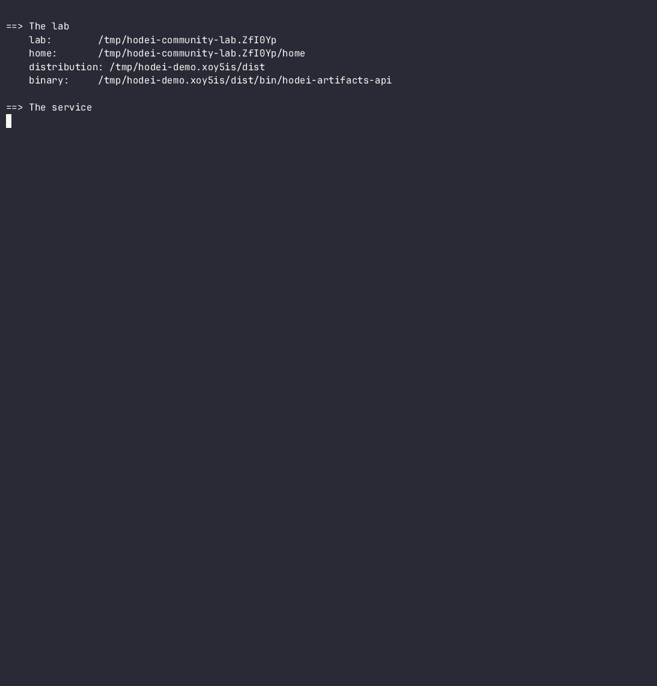

# Hodei Artifacts

> **Part of the [Hodei](https://github.com/hodei-security-platform) security platform** · [Versión en español](README.es.md)

**hodei-artifacts** is the Rust-native artifact registry of **Hodei**: multi-format package hosting, content-addressed storage, Cedar ABAC authorization, and security audit logging in a single standalone binary.

[](LICENSE)
[](https://www.rust-lang.org/)

> **Implementation status:** implemented, verified, and excluded capabilities are tracked in **[ARCHITECTURE_STATUS.md](ARCHITECTURE_STATUS.md)**.



*Real recording of `scripts/community-quickstart.sh run` (digests and ports vary per run). Re-generate it with [`scripts/render-demo.sh`](scripts/render-demo.sh); source recording: [`quickstart-demo.cast`](docs/community/quickstart-demo.cast).*

---

## Production profile: Dgraph + S3 (HSP-314 F2)

The default build and the release archive/OCI image are the **graph profile**: a Dgraph Alpha is the single metadata authority and the bytes live in S3 (`RUN_MODE=dgraph`, `config/dgraph.toml`). The embedded SurrealDB/RocksDB engine is opt-in (`--features legacy`) and is retired in HSP-314 F4. Deploy with [`compose.external.yaml`](compose.external.yaml) (Dgraph + Garage + API), [`compose.yaml`](compose.yaml) (API only, bring your own Dgraph and S3) or the [Helm chart](charts/hodei-artifacts/README.md); see [`docs/community/operations.md`](docs/community/operations.md). The risk facts and the CVE reactor (`POST /api/v1/advisories/accept`) run over Dgraph (HSP-314 F3a/F3b-3); the investigation surface is not wired on this profile yet (HSP-314 F3) and stays closed.

## 60-Second Quickstart (No Rust Required)

> **Graph-profile lab.** The lab below runs the released binary on the graph profile: the script starts a throwaway Dgraph (Zero + Alpha with ACL) and a LocalStack S3 with Podman (`hodei-community-*`, removed when it ends), or uses yours with `--graph-endpoint`, `--s3-endpoint` and `--s3-bucket`. Without Podman and without endpoints it exits 77 (`NOT_RUN`) instead of pretending it ran.

Run an isolated local lab from the release archive — starts the server, mints an ephemeral JWT, creates `raw` + `maven2` repositories, publishes & pulls packages, and verifies digests:

```bash
# VERSION and TARGET select the archive: see "Where the archive comes from" below.
VERSION=0.2.0
TARGET=x86_64-unknown-linux-gnu
PKG="hodei-artifacts-api-$VERSION-$TARGET"

# Verify the digest of the archive, then unpack and run it.
sha256sum -c --ignore-missing "${SUMS:-$PKG.tar.gz.sha256}"
tar -xzf "$PKG.tar.gz" && cd "$PKG"
./community-quickstart.sh run
```

**Where the archive comes from.** `VERSION` and `TARGET` are the two placeholders the block resolves (`TARGET` is `rustc -vV | sed -n 's/^host: //p'` on the machine that built it). Releases are published at <https://github.com/Rubentxu/hodei-artifacts/releases> as `hodei-artifacts-api-<version>-<target>.tar.gz` plus a `SHA256SUMS` file; for a release set `SUMS=SHA256SUMS` before the block (same `sha256sum` format as the `.tar.gz.sha256` that [`scripts/package-release.sh`](scripts/package-release.sh) writes next to the archive). The latest published release (`v0.2.0`) predates the community quickstart and does **not** ship `community-quickstart.sh`: until a newer release is published, build the archive from a checkout with `scripts/package-release.sh` (it writes `dist/hodei-artifacts-api-<version>-<target>.tar.gz` and its `.sha256`) and run the block from `dist/`. [`tests/hsp241_community_quickstart.rs`](tests/hsp241_community_quickstart.rs) extracts this very block and runs it against the archive that script produces, without `cargo` in `PATH`.


- **Full Quickstart Guide:** [`docs/community/quickstart.md`](docs/community/quickstart.md) (or from a source checkout: `scripts/community-quickstart.sh run --archive dist/hodei-artifacts-api-<version>-<target>.tar.gz`)
- **Ecosystem User Guides:** [`docs/community/ecosystems.md`](docs/community/ecosystems.md) — [Maven 2](docs/community/ecosystems.md#maven-2-maven2) · [npm](docs/community/ecosystems.md#npm-npm) · [PyPI](docs/community/ecosystems.md#pypi-pypi) · [OCI](docs/community/ecosystems.md#oci-oci) · [Cargo](docs/community/ecosystems.md#cargo-cargo) · [NuGet](docs/community/ecosystems.md#nuget-nuget) · [Go](docs/community/ecosystems.md#go-go) · [APT](docs/community/ecosystems.md#apt-apt) · [RPM / Yum](docs/community/ecosystems.md#rpm--yum-rpm) · [Helm-OCI](docs/community/ecosystems.md#helm-oci-oci--helm)

---

## Why hodei-artifacts?

- **Fail-closed security by default:** Admin surface (`/api/v1` IAM, policies, schemas, playground) is closed by default (`admin_api_enabled = false`); business routes require verified Bearer JWTs and per-repository Cedar ABAC policies.
- **Content-addressed & auditable:** SHA-256 deduplicated blob hub (`hodei-hub` with local CAS or S3-compatible backend), security audit log, and `hodei-recovery` backup/restore/scrub CLI.
- **10 package ecosystems in one binary:** Native protocol surfaces for `raw`, `oci`, `maven2`, `npm`, `pypi`, `cargo`, `go`, `nuget`, `apt`, and `rpm` (plus Helm charts over OCI), without JVM or GC overhead.
- **Strict public URL governance:** `public_base_url` and `trusted_proxies` are controlled strictly by configuration, never by untrusted `Host` or `X-Forwarded-*` headers.

> **Production Security Rule:** The service does not terminate TLS itself: always put it behind a TLS-terminating reverse proxy and declare the public URL (`public_base_url = "https://..."`; see [`docs/community/configuration.md`](docs/community/configuration.md)) and keep signature/checksum verification enabled (GPG for APT/RPM, digests/signatures for OCI and Helm-OCI, SRI `integrity` for npm, SHA-1/SHA-256 for Maven and PyPI). Local `http://127.0.0.1` examples are strictly scoped to offline development/lab environments.

---

## Capabilities Matrix (`GET /api/v1/capabilities`)

Derived from [`RepositoryFormat::served()`](crates/hodei-catalog/src/model.rs), [`RepositoryFormat::serves_modes()`](crates/hodei-catalog/src/model.rs), and [`conformance.rs`](crates/hodei-catalog/src/conformance.rs):

| Format | `hosted` | `proxy` | `group` | HTTP Route Prefix |
| --- | --- | --- | --- | --- |
| `raw` | Yes | Yes | Yes | `/repository/{repo}/...` |
| `oci` | Yes | Yes | Yes | `/v2/{repo}/...` |
| `maven2` | Yes | Yes | Yes | `/repository/{repo}/...` |
| `npm` | Yes | Yes | Yes | `/npm/{repo}/...` |
| `pypi` | Yes | Yes | Yes | `/pypi/{repo}/...` |
| `cargo` | Yes | No | No | `/cargo/{repo}/...` |
| `go` | Yes | Yes | Yes | `/go/{repo}/...` |
| `nuget` | Yes | Yes | No | `/nuget/{repo}/...` |
| `apt` | Yes | No | No | `/apt/{repo}/...` |
| `rpm` | Yes | No | No | `/yum/{repo}/...` |
| `terraform` | Yes | Yes | No | `/terraform/{repo}/...` |
| `conan` | Yes | No | No | `/conan/{repo}/...` |
| `galaxy` | Yes | No | No | `/galaxy/{repo}/...` |
| `helm` | No | No | No | Declared only; Helm charts use `oci` (`/v2/{repo}/...`) |

---

## Security & Operations

- **Configuration reference:** [`docs/community/configuration.md`](docs/community/configuration.md) · **Operations:** [`docs/community/operations.md`](docs/community/operations.md) · **Release notes template:** [`docs/community/release-notes-template.md`](docs/community/release-notes-template.md)
- **Admin surface:** [`docs/security/admin-surface.md`](docs/security/admin-surface.md) and [`docs/security/production-auth.md`](docs/security/production-auth.md)
- **Repository access & audit events:** [`docs/security/repository-read.md`](docs/security/repository-read.md) and [`docs/security/audit-events.md`](docs/security/audit-events.md)
- **Backup, restore, scrub & repair (`hodei-recovery`):** [`uat/UAT-OPERATIONS.md`](uat/UAT-OPERATIONS.md#recovery--copia-restauración-scrub-y-reparación)
- **Upgrade & release packaging:** [`scripts/package-release.sh`](scripts/package-release.sh) and [`docs/community/ecosystems.md`](docs/community/ecosystems.md#3-operaciones-copia-de-seguridad-restauración-y-actualización)
- **Architecture & Security overview:** [`docs/architecture.md`](docs/architecture.md), [`docs/security.md`](docs/security.md)

---

## Development & Contributing

```bash
# Build workspace
cargo build --workspace

# Run affected tests (day-to-day gate)
./scripts/test-affected.sh

# Run API server from source
cargo run --bin hodei-artifacts-api
```

- **Local CI:** [`pipeline.kts`](pipeline.kts) (PipelineK) and [`docs/ci-strategy.md`](docs/ci-strategy.md)
- **Testing organization:** [`docs/testing-organization.md`](docs/testing-organization.md)
- **UAT contracts:** [`uat/README.md`](uat/README.md), [`uat/UAT-FORMATS.md`](uat/UAT-FORMATS.md)

### Workspace Architecture

The active Rust workspace in [`Cargo.toml`](Cargo.toml) contains 26 members (25 crates under `crates/` plus the root API crate `.`). Nine legacy crates in `crates/` are excluded from the workspace (see [ARCHITECTURE_STATUS.md](ARCHITECTURE_STATUS.md)).

- `.` — `hodei-artifacts-api` (Axum HTTP API, router, handlers, bootstrap, recovery CLI)
- `crates/kernel` — Shared kernel: HRN v2, domain primitives, ports
- `crates/hodei-iam` — Identity & Access Management
- `crates/hodei-policies` — Cedar policy engine: schema, validation, evaluation
- `crates/hodei-evidence` — Evidence domain & verification
- `crates/hodei-evidence-storage` — SurrealDB storage for evidence
- `crates/hodei-trust-policy` — Trust policy & promotion gates
- `crates/hodei-trust-policy-storage` — SurrealDB storage for trust policies
- `crates/hodei-risk` — Risk facts & evaluation
- `crates/hodei-risk-storage` — SurrealDB storage for risk facts
- `crates/hodei-reachability` — Reachability & lineage analysis
- `crates/hodei-reachability-storage` — SurrealDB storage for reachability
- `crates/hodei-reactive` — Reactive event & lifecycle coordination
- `crates/hodei-hub` — Content-addressed blob hub & integrity
- `crates/hodei-hub-s3` — S3-compatible blob store adapter
- `crates/hodei-catalog` — Repository catalog, conformance matrix, proxy/group rules
- `crates/hodei-catalog-storage` — SurrealDB storage for the catalog
- `crates/hodei-audit` — Security audit event log
- `crates/hodei-export-tool` — Portable export tooling
- `crates/hodei-investigator` — Supply-chain investigation engine
- `crates/hodei-investigator-storage` — SurrealDB storage for investigations
- `crates/hodei-simulation` — Policy/graph simulation
- `crates/hodei-simulation-storage` — SurrealDB storage for simulations
- `crates/hodei-counterfactual` — Counterfactual policy evaluation
- `crates/hodei-spike-ladybug` — Graph storage spike
- `crates/hodei-graph-client` — Graph query client

## License

MIT — see [LICENSE](LICENSE).
